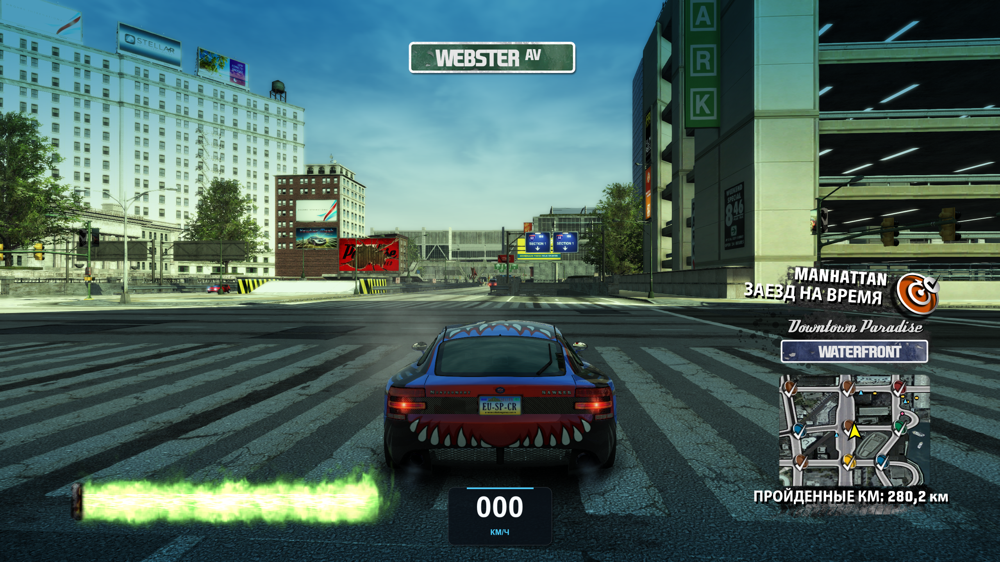
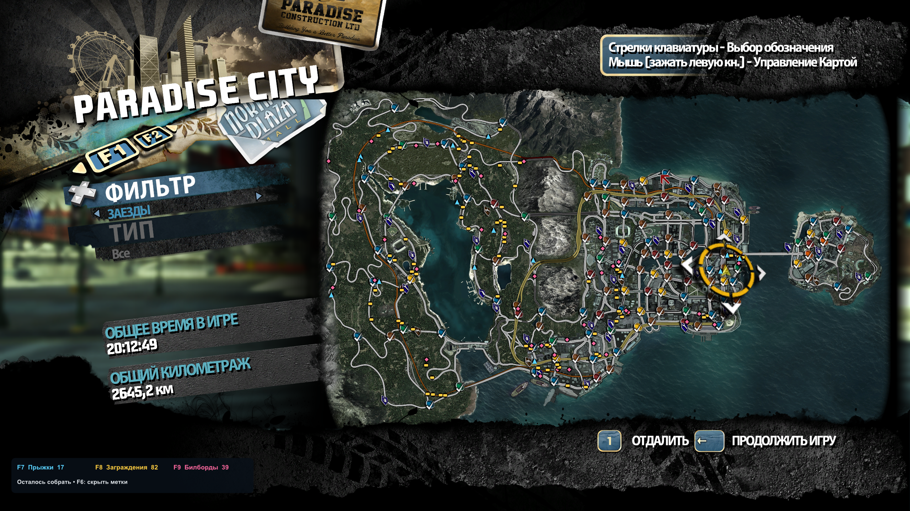

# Карта оставшихся объектов + Center Speedometer — Burnout Paradise Remastered

Метки несобранных объектов на большой карте меню (M) и на миникарте при езде: суперпрыжки — голубые треугольники, заграждения — жёлтые полоски, билборды — розовые ромбы. Учтены Paradise City и Big Surf Island. Данные выполнения читаются из текущего профиля в памяти, обновление — каждые 250 мс. Для прыжков с несколькими въездами показаны соответствующие точки; счётчик считает уникальные прыжки.

## Примеры работы

**Миникарта при езде.** Метки оставшихся объектов отображаются прямо на штатной миникарте в правом нижнем углу. Голубые треугольники обозначают суперпрыжки, жёлтые полоски — заграждения, розовые ромбы — билборды. На скриншоте также виден спидометр в км/ч снизу по центру.

**Большая карта меню (M).** Те же метки помогают искать оставшиеся объекты по всему городу и на Big Surf Island. Панель внизу слева показывает количество оставшихся объектов и клавиши переключения категорий. После сбора объекта его метка исчезает, а счётчик уменьшается.

## Возможности и управление

В версии 1.1 добавлены метки на штатной миникарте. Используются текущие матрицы игры: положение, масштаб по скорости и поворот берутся из того же преобразования, что и сама карта. За пределами миникарты метки скрываются. Цвета и клавиши общие с большой картой.

В версии 1.1.1 исправлено смещение меток вверх в оконном режиме: координаты теперь рассчитываются по фактическому размеру игрового буфера, а не по высоте клиентской области окна. Это учитывает случай, когда буфер 2560×1440 отображается внутри окна 2560×1400, и сохраняет правильную привязку при изменении размера окна.

Исправление 1.1.1 проверено при езде; пользователь подтвердил совпадение метки с объектом на миникарте.

Проверка 1.1 от 04.11.2026: пользователь подтвердил правильное движение меток при езде и поворотах; журнал подтвердил масштабирование миникарты при скорости 0–150 км/ч. Проверка математического преобразования с поворотом на 90° и отсечением границ также прошла. Спидометр продолжает работать.

- F6 — показать/скрыть все метки.
- F7 — переключить прыжки.
- F8 — переключить заграждения.
- F9 — переключить билборды.

Начальные переключатели — в `Collectibles.ini`: `Minimap=1` включает метки при езде, `MenuMap=1` — на большой карте; `0` отключает соответствующий показ. Если параметров нет в настройках версии 1.0, оба показа включены по умолчанию. Мод рассчитан на одиночную игру; метки скрываются в сетевой сессии. Архивы и EXE не меняются; готовый локальный кэш координат создаёт `scripts/prepare_collectibles.py` из вашего `TRIGGERS.DAT`. Кэш содержит игровые данные, поэтому не включается в распространяемый пакет.

Обновление ранее установленного спидометра: закройте игру и выполните `scripts/install_collectibles.ps1`. Скрипт проверяет EXE и принадлежность DLL, сохраняет предыдущую DLL и настройки в `backups/collectibles-*`, создаёт резервную копию профиля, затем обновляет DLL и добавляет `Collectibles.ini` и `Collectibles.bin`. Существующие настройки спидометра и меток сохраняются. Для проверки `CaptureMap=1` сохраняет один кадр карты в `Collectibles-map.bmp`; `0` отключает захват.

Проверка 04.11.2026: все перехватчики подключились, карта проверена по реальному снимку окна при 2560×1421; метки следуют масштабу и перемещению карты. В ходе проверки заграждение было сбито: журнал показал изменение 331→332/475, пользователь подтвердил исчезновение метки и уменьшение счётчика. После проверки осталось 24 суперпрыжка, 143 заграждения и 65 билбордов.

В готовом архиве есть `Install.ps1`: закройте игру и запустите его в PowerShell. Нужен Python 3; сторонних Python-библиотек не требуется. Установщик из архива поддерживает чистую установку или обновление исходного спидометра этого проекта, сохраняет резервные копии в папке `backups` рядом с установщиком и отказывается заменять чужой загрузчик `dinput8.dll`.

## Спидометр

Цифровой спидометр снизу по центру экрана. Скорость в километрах в час, подпись «КМ/Ч». Размер автоматически масштабируется по высоте экрана. Индикатор скрывается вне автомобильного HUD.

## Установка

Закройте игру и запустите `scripts/install.ps1`. Установщик копирует только `dinput8.dll` и `CenterSpeedometer.ini` в `D:\Burnout Paradise Remastered`. Перед этим создаёт резервную копию профиля в `backups/um/backups/bpr-before-center-speedometer` и список исходных файлов. Оригинальный EXE не изменяется. Если уже существует dinput8.dll, установка останавливается.

Запускайте игру обычным способом. Мод автоматически загружается с игрой; отдельная программа не нужна. Разработка и проверка рассчитаны на одиночную игру.

## Настройки

В `CenterSpeedometer.ini`, рядом с игрой:

- `Enabled=1`: включение; `0`: выключение.
- `Scale=1.0`: размер (0.5–2).
- `BottomMargin=32`: отступ снизу в пикселях при 1080p; масштабируется вместе с индикатором.
- `Opacity=0.82`: непрозрачность фона (0.1–1).

Настройки читаются при запуске игры. Диагностика: `CenterSpeedometer.log` в папке игры.

## Удаление

Закройте игру и запустите `scripts/uninstall.ps1`. Скрипт проверяет, что DLL принадлежит этой установке, и удаляет только файлы спидометра. Также можно вручную убрать `dinput8.dll` и `CenterSpeedometer.ini`, добавленные установщиком.

## Сборка и совместимость

Visual Studio 2022 C++, Windows SDK, CMake; запуск `scripts/build.ps1`. Целевая платформа Win32/x86, D3D11. Проверена структура EXE: timestamp `0x5B365B73`, SizeOfImage `0x07F7E000`; другая структура отключает чтение скорости. Скорость берётся из существующей телеметрии HUD в целых милях/ч, преобразуется множителем 1.609344 и округляется; из-за исходного округления шаг показаний может составлять 1–2 км/ч.
